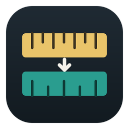
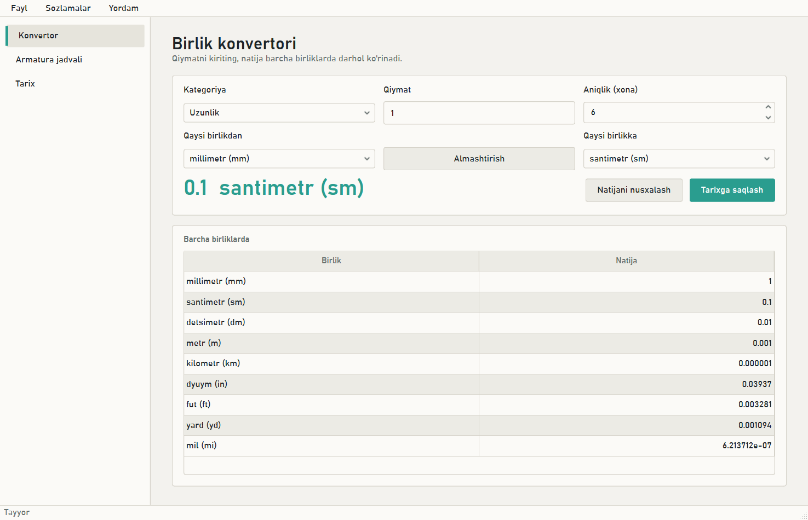
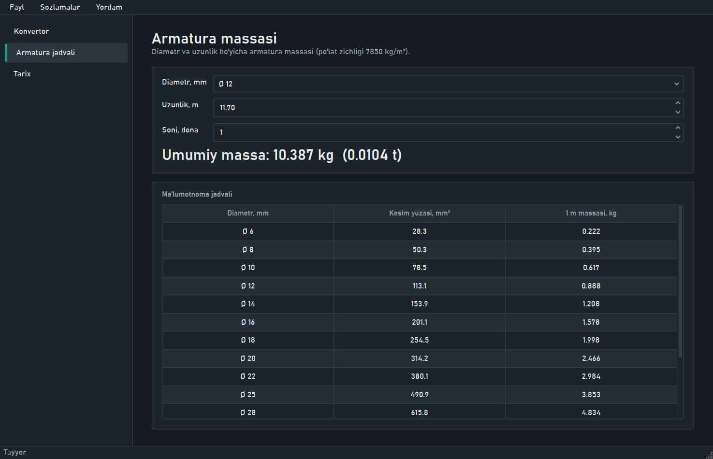

<h1 align="center">Birlik konvertori</h1>

<b>Unit Converter</b> · Конвертер единиц

   
  
  
  
  

Qurilish, muhandislik va kundalik hisob-kitoblar uchun o'lchov birliklarini o'tkazuvchi dastur: uzunlik, maydon, hajm, massa, bosim, kuch, harorat va armatura massasi jadvali.

## Imkoniyatlar

- 12 kategoriya, 70 dan ortiq birlik
- Natija bir vaqtda barcha birliklarda
- Sotix, gektar, kgk/sm², tk/m² kabi mahalliy birliklar
- Nishablik (%) ↔ gradus
- Armatura massasi kalkulyatori va ma'lumotnoma jadvali
- Hisob-kitoblar tarixi va CSV eksport
- O'zbek, rus, ingliz tillari; yorug' va qorong'i mavzu

## O'rnatish

1. [**BirlikKonvertori.exe**](https://github.com/eduhakimov/birlik-konvertori/releases/latest/download/BirlikKonvertori.exe) faylini yuklab oling.
2. Faylni ishga tushiring, o'rnatish shart emas.
3. Windows SmartScreen ogohlantirsa: **Batafsil → Baribir ishga tushirish**.

**Tizim talablari:** Windows 10 (1809+) / Windows 11, x64

---

## Русский

Программа перевода единиц измерения для строительства, инженерии и повседневных расчётов: длина, площадь, объём, масса, давление, сила, температура и таблица массы арматуры.

- 12 категорий, более 70 единиц
- Результат сразу во всех единицах
- Местные единицы: сотка, гектар, кгс/см², тс/м²
- Уклон (%) ↔ градусы
- Калькулятор массы арматуры и справочная таблица
- История расчётов и экспорт в CSV
- Узбекский, русский, английский; светлая и тёмная тема

## English

A unit conversion tool for construction, engineering and everyday calculations: length, area, volume, mass, pressure, force, temperature and a rebar mass table.

- 12 categories, 70+ units
- Result shown in all units at once
- Local units: sotix, hectare, kgf/cm², tf/m²
- Slope (%) ↔ degrees
- Rebar mass calculator and reference table
- Calculation history and CSV export
- Uzbek, Russian, English; light and dark themes

---

## Muallif / Author

**Bahtiyorjon Hakimov** (Hakimov Bahtiyorjon Muzaffar o'g'li), [github.com/eduhakimov](https://github.com/eduhakimov)

© 2026 Bahtiyorjon Hakimov. Barcha huquqlar himoyalangan. / Все права защищены. / All rights reserved.
Batafsil: [LICENSE](LICENSE) · Uchinchi tomon komponentlari: [THIRD_PARTY_NOTICES.md](THIRD_PARTY_NOTICES.md)
