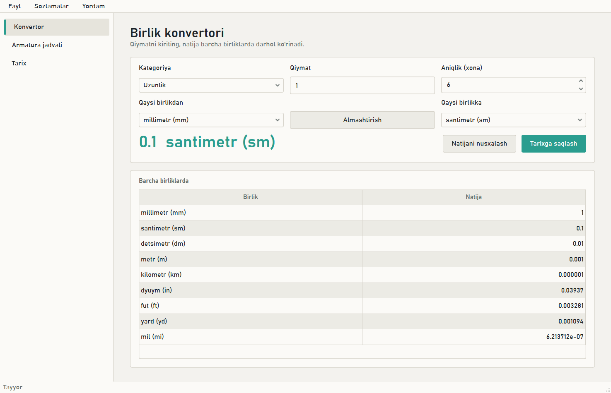
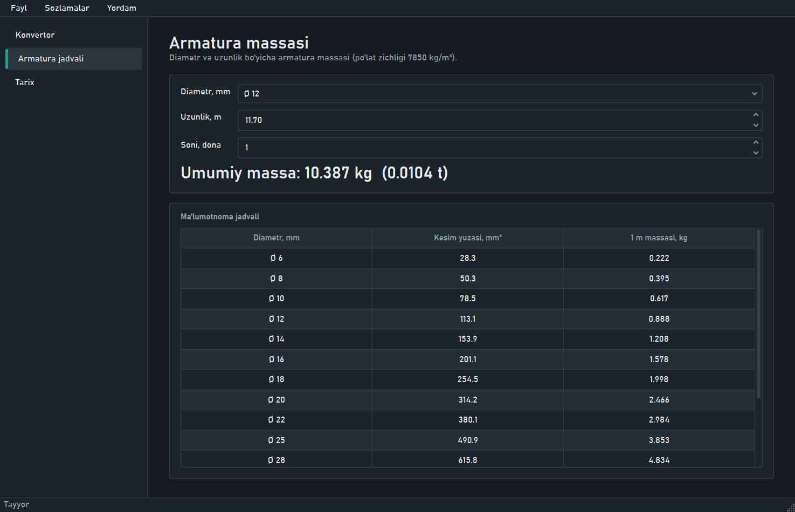

# Birlik konvertori: Foydalanish qo‘llanmasi

Muallif: Hakimov Bahtiyorjon. Versiya: 1.0.2.

## 1. Umumiy ma’lumot

“Birlik konvertori” o‘lchov birliklarini bir-biriga o‘tkazuvchi Windows dasturidir. Siz qiymatni bitta maydonga yozasiz, dastur esa natijani darhol tanlangan birlikda va shu kategoriyaning barcha boshqa birliklarida ko‘rsatadi.

Dasturda 12 ta kategoriya bor: uzunlik, maydon, hajm, massa, zichlik, bosim / kuchlanish, kuch, tezlik, burchak, harorat, energiya / quvvat va ma’lumot hajmi. Jami 70 ta birlik mavjud, jumladan sotix (100 m²), gektar, sentner, kgk/sm², tk/m² va nishablik foizi.

Bundan tashqari, dasturda armatura massasini hisoblash sahifasi va diametrlar bo‘yicha ma’lumotnoma jadvali, shuningdek hisob-kitoblar tarixini saqlash va CSV faylga eksport qilish imkoniyati bor.

Dastur quyidagi foydalanuvchilar uchun mo‘ljallangan:

- qurilish va loyihalash sohasidagi muhandis, texnik, prorab va smetachilar;
- texnik yo‘nalishdagi talabalar, o‘qituvchilar va o‘quvchilar;
- turli birliklardagi ma’lumotlar (bosim, harorat, maydon, ma’lumot hajmi) bilan ishlaydigan har qanday foydalanuvchi.

## 2. Tizim talablari

- Operatsion tizim: Windows 10 (1809 versiyasi yoki undan keyingi) yoki Windows 11, 64 bitli (x64).
- Internet: shart emas. Dastur to‘liq oflayn ishlaydi va tarmoqqa hech qanday so‘rov yubormaydi.
- O‘rnatish: talab qilinmaydi. Dastur bitta BirlikKonvertori.exe faylidan iborat.
- Qo‘shimcha dasturlar: Python yoki boshqa kutubxonalarni o‘rnatish shart emas, kerakli barcha komponentlar exe fayl ichida.
- Disk: sozlamalar va tarix uchun foydalanuvchi profilida kichik hajmdagi fayllar yaratiladi.

## 3. O‘rnatish va ishga tushirish

1. Brauzerda dasturning GitHub sahifasini oching: https://github.com/eduhakimov/birlik-konvertori va “Releases” bo‘limiga o‘ting.
2. Oxirgi versiyadagi BirlikKonvertori.exe faylini yuklab oling.
3. Faylni o‘zingizga qulay papkaga (masalan, “Hujjatlar” yoki ish stoliga) joylashtiring.
4. Faylni ikki marta bosib ishga tushiring. O‘rnatish oynasi chiqmaydi, dastur bevosita ochiladi.
5. Birinchi ishga tushirishda Windows SmartScreen “Windows kompyuteringizni himoya qildi” ogohlantirishini ko‘rsatishi mumkin. Bu dastur raqamli imzo bilan imzolanmaganligi bilan bog‘liq. Davom etish uchun “Batafsil” havolasini bosing, so‘ngra “Baribir ishga tushirish” tugmasini bosing.
Dastur standart holatda o‘zbek tilida ochiladi. Birinchi ochilishda “Konvertor” sahifasi, “Uzunlik” kategoriyasi va qiymat maydonida 1 soni ko‘rinadi.

## 4. Dastur oynasi bilan tanishish

Dastur oynasi to‘rt qismdan iborat:

- **Menyu qatori** (yuqorida): “Fayl” (ichida “Chiqish”), “Sozlamalar” (“Til” va “Mavzu”), “Yordam” (“Qo‘llanma” va “Dastur haqida”).
- **Navigatsiya paneli** (chapda): “Konvertor”, “Armatura jadvali” va “Tarix” bo‘limlari. Kerakli bo‘limni bosish orqali sahifa almashtiriladi.
- **Ish maydoni** (o‘rtada): tanlangan sahifaning maydonlari, tugmalari va jadvallari.
- **Holat qatori** (pastda): “Tayyor”, “Nusxalandi” kabi qisqa xabarlar chiqadi.
“Konvertor” sahifasining yuqori qismida “Kategoriya”, “Qiymat”, “Aniqlik (xona)”, “Qaysi birlikdan”, “Qaysi birlikka” maydonlari va “Almashtirish” tugmasi joylashgan. Ularning ostida natija katta harflar bilan yoziladi, yonida “Natijani nusxalash” va “Tarixga saqlash” tugmalari bor. Pastda “Barcha birliklarda” jadvali “Birlik” va “Natija” ustunlari bilan ko‘rsatiladi.

“Armatura jadvali” sahifasida “Diametr, mm”, “Uzunlik, m”, “Soni, dona” maydonlari, “Umumiy massa” natijasi va “Ma’lumotnoma jadvali” joylashgan.

*1-rasm. Dastur oynasi, “Konvertor” sahifasi: yuqorida menyu, chapda navigatsiya paneli, o‘rtada kiritish maydonlari, natija va “Barcha birliklarda” jadvali*

*2-rasm. “Armatura jadvali” sahifasi qorong‘i mavzuda: diametr, uzunlik va son maydonlari, umumiy massa va ma’lumotnoma jadvali*

## 5. Asosiy amallar

**Qiymatni boshqa birlikka o‘tkazish**

1. Chap paneldagi “Konvertor” bo‘limini tanlang.
2. “Kategoriya” ro‘yxatidan kerakli kattalikni tanlang, masalan, “Bosim / kuchlanish”.
3. “Qiymat” maydoniga son yozing. Kasr qismini nuqta yoki vergul bilan ajratish mumkin (1.5 yoki 1,5). Minglik guruhlar orasidagi bo‘sh joy e’tiborga olinmaydi.
4. “Qaysi birlikdan” ro‘yxatidan boshlang‘ich birlikni, “Qaysi birlikka” ro‘yxatidan esa kerakli birlikni tanlang.
5. Natija darhol katta harflar bilan ko‘rinadi. Alohida tugma bosish shart emas.
6. Qiymat shu kategoriyaning barcha birliklarida qanday bo‘lishini “Barcha birliklarda” jadvalidan ko‘ring.
Agar maydonga son bo‘lmagan matn yozilsa, natija o‘rnida “Son noto‘g‘ri kiritildi” xabari chiqadi va jadval bo‘shatiladi. Bu holda qiymatni to‘g‘rilang.

Natija bir vaqtning o‘zida ikki joyda ko‘rsatiladi. Katta yozuvda faqat “Qaysi birlikka” maydonida tanlangan birlikdagi natija va birlik nomi turadi. “Barcha birliklarda” jadvalida esa xuddi shu qiymat kategoriyadagi har bir birlikka o‘tkazilgan holda beriladi. Shuning uchun ko‘p hollarda maqsad birlikni tanlash shart ham emas: qiymatni yozib, jadvaldan kerakli qatorni topish kifoya. Jadval faqat o‘qish uchun, undagi qiymatlarni tahrirlab bo‘lmaydi.

Quyida kategoriyalar bo‘yicha amaliy misollar keltirilgan. Ularni dasturda takrorlab, ishlash tartibini mustahkamlashingiz mumkin:

- **Uzunlik:** 1 mil = 1,609344 km; 12 dyuym = 1 fut.
- **Maydon:** 1 gektar = 100 sotix; 1 sotix = 100 m².
- **Hajm:** 1 gallon (AQSh) = 3,785411784 litr.
- **Massa:** 1 tonna = 10 sentner; 1 funt = 16 unsiya.
- **Zichlik:** 2,4 t/m³ = 2400 kg/m³.
- **Bosim / kuchlanish:** 1 atmosfera = 760 mm simob ustuni; 1 kgk/sm² = 0,0980665 MPa.
- **Kuch:** 1 tonna-kuch = 9,80665 kN.
- **Tezlik:** 100 km/soat ≈ 27,78 m/s; 1 tugun = 1,852 km/soat.
- **Harorat:** 100 °C = 212 °F; 0 K = −273,15 °C.
- **Energiya / quvvat:** 1 kVt·soat ≈ 859,85 kkal.
- **Ma’lumot hajmi:** 1 GB = 1024 MB.
**Birliklar o‘rnini almashtirish**

1. “Almashtirish” tugmasini bosing.
2. “Qaysi birlikdan” va “Qaysi birlikka” maydonlaridagi birliklar o‘rin almashadi, natija yangidan hisoblanadi.
**Aniqlikni o‘zgartirish**

1. “Aniqlik (xona)” maydonidagi qiymatni 0 dan 12 gacha o‘zgartiring. Bu natijadagi kasr xonalari soni.
2. Ortiqcha nollar avtomatik olib tashlanadi. Juda katta yoki juda kichik sonlar ilmiy yozuvda (masalan, 6.213712e-07) ko‘rsatiladi.
3. Tanlangan aniqlik va oxirgi kategoriya eslab qolinadi va dastur keyingi safar ochilganda tiklanadi.
**Natijani nusxalash**

1. “Natijani nusxalash” tugmasini bosing.
2. Natijaning son qismi almashinuv buferiga olinadi, holat qatorida “Nusxalandi” yozuvi chiqadi.
3. Sonni Ctrl+V tugmalari yordamida boshqa dasturga qo‘ying.
**Nishablikni burchakka o‘tkazish**

1. “Kategoriya” ro‘yxatidan “Burchak”ni tanlang.
2. “Qaysi birlikdan” ro‘yxatidan “nishablik (%)”, “Qaysi birlikka” ro‘yxatidan “gradus (°)” ni tanlang.
3. Qiymatga nishablik foizini yozing. Masalan, 100 % nishablik 45° ga teng.
**Armatura massasini hisoblash**

1. Chap paneldagi “Armatura jadvali” bo‘limini tanlang.
2. “Diametr, mm” ro‘yxatidan diametrni tanlang (Ø6 dan Ø40 gacha).
3. “Uzunlik, m” maydoniga bitta sterjen uzunligini kiriting.
4. “Soni, dona” maydoniga sterjenlar sonini kiriting.
5. “Umumiy massa” qatorida natija kilogramm va qavs ichida tonnada ko‘rsatiladi.
6. “Ma’lumotnoma jadvali”dan har bir diametrning kesim yuzasi (mm²) va 1 metr massasini (kg) ko‘ring.
Hisob po‘latning 7850 kg/m³ zichligi bo‘yicha nazariy formula asosida bajariladi: 1 metr massasi π·d²/4·7850 ga teng, umumiy massa esa shu qiymatni uzunlik va songa ko‘paytirib topiladi. Natija maydonlardan biri o‘zgarishi bilan darhol yangilanadi. Uzunlik ikki kasr xonasigacha (masalan, 11,70 m), son esa 1 dan 1 000 000 donagacha kiritiladi.

Misol: Ø12 diametrli, 11,70 m uzunlikdagi bitta sterjenning massasi 10,387 kg (0,0104 t) ga teng. Agar sonni 100 dona qilsangiz, umumiy massa 1038,7 kg atrofida bo‘ladi. Shu tarzda buyurtma qilinadigan armatura tonnajini tezda baholash mumkin.

**Tarix bilan ishlash**

1. “Konvertor” sahifasida natija olingandan so‘ng “Tarixga saqlash” tugmasini bosing. Yozuv sana va vaqt bilan “Tarix” bo‘limiga qo‘shiladi, eng yangisi ro‘yxat boshida turadi.
2. Chap paneldagi “Tarix” bo‘limini oching va saqlangan yozuvlarni ko‘ring.
3. Tarixni faylga yozish uchun “CSV ga eksport” tugmasini bosing, papka va fayl nomini tanlang (standart holatda “Hujjatlar” papkasida tarix.csv) va saqlang.
4. Tarixni butunlay o‘chirish uchun “Tozalash” tugmasini bosing.
Tarix bo‘sh bo‘lsa, “Tarix bo‘sh” yozuvi ko‘rinadi va eksport hamda tozalash tugmalari faol bo‘lmaydi. Noto‘g‘ri qiymat tarixga saqlanmaydi.

Har bir tarix yozuvi quyidagi tartibda tuziladi: sana va vaqt (YYYY-MM-DD HH:MM), kiritilgan qiymat, boshlang‘ich birlik, tenglik belgisi va natija birligi bilan. CSV faylda har bir yozuv alohida qatorda joylashadi. Fayl UTF-8 kodlashida saqlanadi, shuning uchun o‘zbek, rus va ingliz harflari elektron jadvalda to‘g‘ri ko‘rinadi. Tozalash amali qaytarilmaydi, shuning uchun kerakli yozuvlarni oldindan eksport qilib qo‘ying.

**Dasturdan chiqish**

“Fayl” menyusidagi “Chiqish” bandini tanlang yoki oynani yopish tugmasini bosing. Oynaning o‘lchami va joylashuvi, tanlangan kategoriya, aniqlik va tarix avtomatik saqlanadi, alohida saqlash amali talab qilinmaydi.

## 6. Sozlamalar

**Tilni almashtirish**

1. “Sozlamalar” menyusini oching va “Til” bandini tanlang.
2. O‘zbekcha, Русский yoki English variantlaridan birini bosing.
3. Dastur “Tilni o‘zgartirish uchun dastur qayta ishga tushiriladi. Davom etasizmi?” deb so‘raydi. Rozilik bersangiz, dastur yangi tilda qayta ochiladi.
**Mavzuni tanlash**

1. “Sozlamalar” menyusidan “Mavzu” bandini tanlang.
2. “Tizim bo‘yicha”, “Yorug‘” yoki “Qorong‘i” variantlaridan birini tanlang. Mavzu darhol qo‘llanadi va eslab qolinadi.
**Yordam**

“Yordam” menyusidagi “Qo‘llanma” bandi dastur ichidagi qisqa qo‘llanmani joriy tilda ochadi. “Dastur haqida” bandi versiya va muallif haqidagi ma’lumotni ko‘rsatadi.

## 7. Ma’lumotlarni saqlash va xavfsizlik

- Dastur internetga ulanmaydi va hech qanday ma’lumotni tashqariga yubormaydi.
- Sozlamalar (til, mavzu, oxirgi kategoriya, aniqlik, oyna o‘lchami) va hisob-kitoblar tarixi %APPDATA%\BahtiyorSoft\birlik-konvertori papkasidagi settings.json faylida saqlanadi.
- Tarixda eng ko‘pi 500 ta oxirgi yozuv saqlanadi.
- Sozlamalar fayli xavfsiz usulda yoziladi: avval vaqtinchalik faylga yozilib, keyin almashtiriladi. Agar fayl buzilgan bo‘lsa, u .broken.json nomli zaxira faylga o‘zgartiriladi va dastur toza sozlamalar bilan ochiladi.
- Kutilmagan xatolar haqida ma’lumot shu papkadagi log.txt jurnal fayliga yoziladi.
- Dastur faqat siz “CSV ga eksport” orqali tanlagan joyga fayl yozadi. Boshqa fayllaringiz o‘qilmaydi va o‘zgartirilmaydi.
- Dasturni olib tashlash uchun BirlikKonvertori.exe faylini o‘chirish kifoya. Sozlamalarni ham tozalash uchun yuqoridagi papkani o‘chirish mumkin.

## 8. Ko‘p uchraydigan savollar va muammolar

**Natija o‘rnida “Son noto‘g‘ri kiritildi” yozuvi chiqdi.** Qiymat maydonida harf yoki ortiqcha belgilar bo‘lishi mumkin. Faqat raqamlar, bitta kasr ajratgichi (nuqta yoki vergul) va kerak bo‘lsa minus ishorasini qoldiring. Juda katta qiymatlar ham rad etiladi.

**Natija 6.213712e-07 kabi ko‘rinishda chiqdi.** Bu ilmiy yozuv: 6,213712·10⁻⁷. Juda kichik yoki juda katta sonlar shu tarzda ko‘rsatiladi.

**Natija kerakli aniqlikda emas.** “Aniqlik (xona)” maydonidagi qiymatni oshiring.

**KB va MB nega 1000 emas, 1024 ga farq qiladi?** Dasturda ma’lumot hajmi birliklari ikkilik qadam bilan, ya’ni 1 KB = 1024 bayt deb hisoblanadi.

**Nishablik juda katta son ko‘rsatmoqda.** 90° ga yaqin burchaklarda nishablik foizi keskin ortadi. Bu matematik xususiyat, xato emas.

**CSV faylga eksport qilishda xato chiqdi.** “Faylni yozib bo‘lmadi. U boshqa dasturda ochiq bo‘lishi mumkin.” xabari faylning masalan elektron jadvalda ochiq turganini bildiradi. Faylni yoping yoki boshqa nom tanlang.

**“CSV ga eksport” tugmasi bosilmayapti.** Tarix bo‘sh bo‘lsa, bu tugma faol bo‘lmaydi. Avval “Konvertor” sahifasida “Tarixga saqlash” tugmasini bosing.

**Armatura massasi zavod ma’lumotlaridan biroz farq qiladi.** Dastur nazariy formula (7850 kg/m³ zichlik va doiraviy kesim) bo‘yicha hisoblaydi. Aniq qiymatlar uchun ishlab chiqaruvchi yoki standart ma’lumotlariga murojaat qiling.

**Windows dasturni ishga tushirishga ruxsat bermayapti.** SmartScreen oynasida “Batafsil” va “Baribir ishga tushirish” tugmalarini bosing.

**Dastur boshqa tilda ochildi.** “Sozlamalar” menyusidagi “Til” bandidan O‘zbekcha variantini tanlang va qayta ishga tushirishga rozilik bering.

**Kerakli birlik ro‘yxatda yo‘q.** Avval to‘g‘ri kategoriya tanlanganini tekshiring: masalan, kgk/sm² “Bosim / kuchlanish”, kgk esa “Kuch” kategoriyasida joylashgan. Ro‘yxatda bo‘lmagan birliklarni dasturga foydalanuvchi qo‘sha olmaydi.

**Kutilmagan xato oynasi chiqdi.** Xabarda ko‘rsatilgan log.txt jurnal fayli %APPDATA%\BahtiyorSoft\birlik-konvertori papkasida joylashgan. Muammo haqida xabar berishda shu fayl mazmunini ilova qiling.

