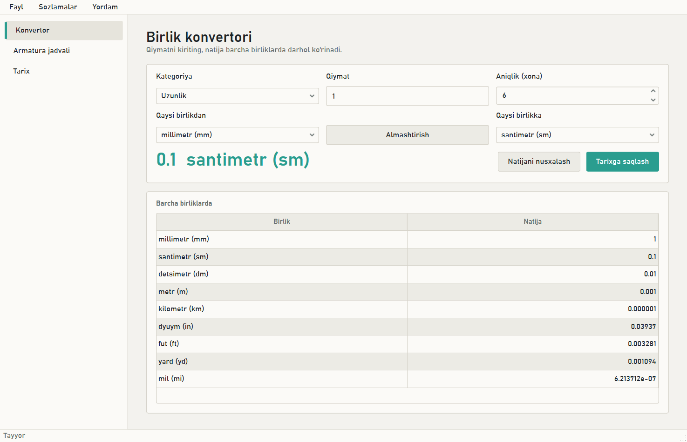
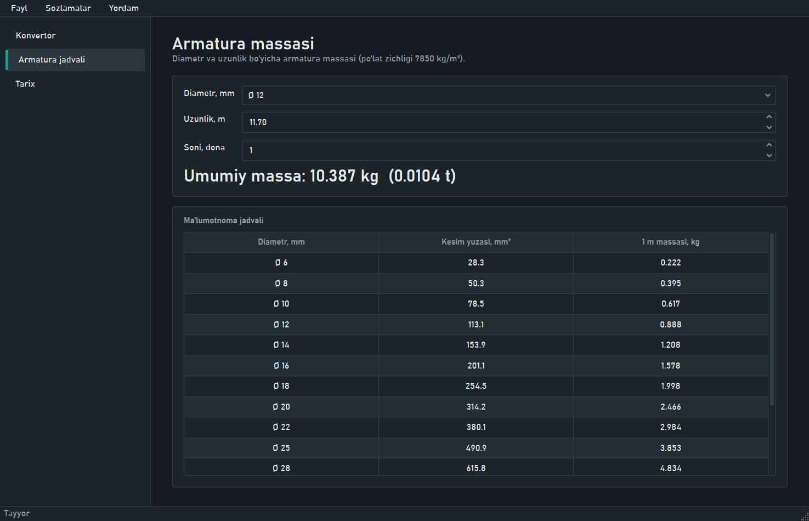

UDK: 004.42:006.91

# Qurilish va muhandislik hisob-kitoblari uchun o‘lchov birliklarini o‘tkazishning oflayn dasturiy vositasi: birliklar modeli, arxitektura va amalga oshirish

**Hakimov Bahtiyorjon**  
*[ish joyi, lavozimi, elektron pochta]*

**Annotatsiya.** Maqolada qurilish, muhandislik va kundalik hisob-kitoblarda uchraydigan o‘lchov birliklarini o‘zaro o‘tkazish uchun ishlab chiqilgan “Birlik konvertori” ish stoli dasturi tavsiflanadi. Dastur Python 3.12 va PySide6 (Qt 6) asosida yaratilgan, internet aloqasisiz ishlaydi va 12 ta kategoriyada 70 ta birlikni qamrab oladi, jumladan sotix, gektar, kgk/sm², tk/m² kabi mahalliy amaliyotda keng qo‘llanadigan birliklarni. Birliklar asosiy birlikka nisbatan ko‘paytuvchilar jadvali ko‘rinishida modellashtirilgan, harorat va nishablik foizi uchun alohida chiziqli bo‘lmagan o‘tkazish qoidalari amalga oshirilgan. Dasturda armatura massasini hisoblash moduli, ma’lumotnoma jadvali, hisob-kitoblar tarixi va uni CSV formatiga eksport qilish imkoniyati mavjud. Ishonchlilik 46 ta avtomatik test bilan tekshirilgan.

*Kalit so‘zlar:* o‘lchov birliklari, birliklarni o‘tkazish, qurilish hisob-kitoblari, armatura massasi, nishablik, PySide6, oflayn dastur.

**Офлайн-программное средство перевода единиц измерения для строительных и инженерных расчётов: модель единиц, архитектура и реализация**

**Аннотация.** В статье описывается настольная программа «Конвертер единиц», предназначенная для взаимного перевода единиц измерения, встречающихся в строительных, инженерных и повседневных расчётах. Программа разработана на Python 3.12 и PySide6 (Qt 6), работает без подключения к интернету и охватывает 70 единиц в 12 категориях, включая широко применяемые в местной практике сотку, гектар, кгс/см² и тс/м². Единицы смоделированы как таблица множителей относительно базовой единицы, для температуры и уклона в процентах реализованы отдельные нелинейные правила перевода. Программа содержит модуль расчёта массы арматуры, справочную таблицу, историю расчётов и экспорт истории в формат CSV. Надёжность проверена 46 автоматическими тестами.

*Ключевые слова:* единицы измерения, перевод единиц, строительные расчёты, масса арматуры, уклон, PySide6, офлайн-программа.

**An offline software tool for converting units of measurement in construction and engineering calculations: unit model, architecture and implementation**

**Abstract.** The article describes the desktop application “Unit Converter”, designed for converting units of measurement that occur in construction, engineering and everyday calculations. The application is built with Python 3.12 and PySide6 (Qt 6), works without an internet connection and covers 70 units in 12 categories, including units widely used in local practice such as the sotix, hectare, kgf/cm² and tf/m². Units are modelled as a table of factors relative to a base unit, while temperature and slope in percent are handled by separate non-linear conversion rules. The application includes a rebar mass calculator, a reference table, a calculation history and export of that history to CSV. Its reliability is checked by 46 automated tests.

*Keywords:* units of measurement, unit conversion, construction calculations, rebar mass, slope, PySide6, offline application.

## Kirish

O‘lchov birliklari bilan ishlash muhandislik, qurilish, loyihalash va ta’lim jarayonining ajralmas qismidir. Loyiha hujjatlarida, me’yoriy adabiyotlarda, uskunalar pasportlarida va xorijiy katalog ma’lumotlarida bir xil fizik kattalik turli birliklarda ifodalanadi. Masalan, beton yoki grunt mustahkamligi MPa, kgk/sm² yoki tk/m² orqali, nasos va kompressorlar bosimi bar, atmosfera yoki psi orqali, quvur va armatura o‘lchamlari millimetr yoki dyuymda beriladi. Yer maydonlari esa amaliyotda ko‘pincha sotix va gektarda hisoblanadi.

Bunday sharoitda birliklarni qo‘lda o‘tkazish vaqt talab qiladi va xatolar ehtimolini oshiradi. Ko‘paytuvchini noto‘g‘ri eslab qolish, o‘nlik tartibini adashtirish yoki chiziqli bo‘lmagan bog‘lanishni (masalan, harorat shkalalari yoki nishablik foizi bilan burchak orasidagi munosabatni) oddiy ko‘paytirish deb qabul qilish natijaning bir necha marta farq qilishiga olib keladi. Qurilishda bunday xatolar materiallar hajmini noto‘g‘ri baholash, smeta va buyurtmalarda nomuvofiqlikka sabab bo‘lishi mumkin.

O‘zbekiston Respublikasida “Raqamli O‘zbekiston – 2030” strategiyasi doirasida iqtisodiyot tarmoqlari, jumladan qurilish sohasi va ta’lim tizimini raqamlashtirish davlat siyosatining ustuvor yo‘nalishlaridan biri sifatida belgilangan. Raqamlashtirishning amaliy darajadagi muhim tarkibiy qismi mutaxassisning kundalik ish jarayonida foydalanadigan, mahalliy tilda ishlaydigan va ishonchli natija beradigan dasturiy vositalardir.

Ushbu maqolada muallif tomonidan ishlab chiqilgan “Birlik konvertori” dasturi ilmiy-amaliy yechim sifatida ko‘rib chiqiladi. Dastur o‘zbek, rus va ingliz tillarida ishlaydi, internet talab qilmaydi va qurilish amaliyotiga xos birliklarni, shuningdek armatura massasini hisoblash vositasini bitta oynada birlashtiradi. Maqolaning maqsadi dasturning birliklar modeli, arxitekturasi, amalga oshirilgan funksiyalari va sinov natijalarini tavsiflash hamda uning cheklovlari va rivojlantirish istiqbollarini muhokama qilishdan iborat.

## Muammoning qo‘yilishi va mavjud yechimlar tahlili

O‘lchov birliklarini o‘tkazish masalasi formal jihatdan oddiy ko‘rinsa-da, amaliyotda bir nechta talablarni birgalikda qondirishni taqozo etadi: o‘tkazish koeffitsiyentlarining aniqligi, chiziqli bo‘lmagan bog‘lanishlarni to‘g‘ri qayta ishlash, natijani o‘qish uchun qulay shaklda ko‘rsatish, mahalliy birliklarni qo‘llab-quvvatlash va foydalanuvchi interfeysining ona tilida bo‘lishi.

Mavjud yechimlarni umumiy holda bir nechta guruhga ajratish mumkin.

- Onlayn konvertorlar va qidiruv tizimlariga o‘rnatilgan hisoblagichlar. Ular qulay, biroq internet aloqasini talab qiladi, qurilish maydonchasi yoki aloqa cheklangan xonalarda har doim ham mavjud bo‘lmaydi. Ko‘pchiligida mahalliy birliklar (sotix, kgk/sm², tk/m²) bo‘lmasligi yoki boshqa nom bilan berilishi mumkin.
- Mobil ilovalar. Ular tezkor foydalanish uchun qulay, ammo kompyuterda loyiha hujjatlari bilan ishlayotgan mutaxassis uchun qurilmalar o‘rtasida o‘tish noqulaylik tug‘diradi.
- Elektron jadvallar (masalan, jadval protsessorlaridagi o‘zgartirish funksiyalari) va muhandislik hisob-kitob paketlari. Ular kuchli vosita, ammo foydalanuvchidan funksiya sintaksisi va birlik belgilarini bilishni talab qiladi.
- Ma’lumotnoma jadvallari va qo‘lda hisoblash. Bu usul an’anaviy bo‘lib, inson omili bilan bog‘liq xatolarga eng ko‘p moyil.
Shu sababli quyidagi masala qo‘yildi: Windows operatsion tizimi uchun internetga bog‘liq bo‘lmagan, o‘rnatishni talab qilmaydigan, o‘zbek tilidagi interfeysga ega, qurilish amaliyotida uchraydigan birliklarni qamrab oluvchi va qiymatni bir vaqtning o‘zida tanlangan kategoriyaning barcha birliklarida ko‘rsatadigan dasturiy vosita yaratish. Qo‘shimcha talab sifatida armatura massasini diametr va uzunlik bo‘yicha hisoblash hamda bajarilgan hisob-kitoblarni saqlab, keyinchalik hujjatlashtirish uchun eksport qilish imkoniyati belgilandi.

## Tadqiqot metodologiyasi va dasturiy arxitektura

Dastur Python 3.12 dasturlash tilida yozilgan, grafik interfeys Qt 6 kutubxonasining rasmiy Python bog‘lamasi bo‘lgan PySide6 yordamida qurilgan. Tarqatish uchun dastur PyInstaller vositasi bilan bitta bajariladigan BirlikKonvertori.exe fayliga yig‘iladi, shuning uchun foydalanuvchi kompyuterida Python yoki qo‘shimcha kutubxonalarni o‘rnatish talab etilmaydi. Hisoblash qismi faqat Python standart kutubxonasidan (math, csv, datetime) foydalanadi.

Loyiha uchta mantiqiy qatlamdan iborat:

- **Birliklar modeli** (units.py moduli). Bu modul interfeysdan to‘liq mustaqil bo‘lib, barcha kategoriyalar, birliklar, ularning uch tildagi nomlari, o‘tkazish funksiyasi, armatura hisobi va sonlarni formatlash funksiyasini o‘z ichiga oladi. Interfeysdan ajratilganligi uni avtomatik testlar bilan alohida tekshirish imkonini beradi.
- **Interfeys qatlami** (window.py moduli). Unda uchta sahifa amalga oshirilgan: “Konvertor”, “Armatura jadvali” va “Tarix”. Sahifalar chap tomondagi navigatsiya paneli orqali almashtiriladi.
- **Umumiy karkas** (uzkit paketi). U asosiy oyna, menyular, uch tilli tarjima tizimi, yorug‘ va qorong‘i mavzular, sozlamalarni saqlash, jurnal yuritish va kutilmagan xatolarni ushlash vazifalarini bajaradi. Interfeys matnlari strings.py faylida uz, ru va en kalitlari bilan saqlanadi.
Birliklar modelining asosiy g‘oyasi har bir kategoriya uchun bitta asosiy birlik tanlash va qolgan barcha birliklarni shu asosiy birlikka nisbatan ko‘paytuvchi orqali ifodalashdan iborat. Masalan, uzunlik uchun asosiy birlik metr, maydon uchun m², hajm uchun m³, massa uchun kilogramm, bosim uchun paskal, kuch uchun nyuton, energiya uchun joul. Bunda x qiymatni a birlikdan b birlikka o‘tkazish ikki bosqichda bajariladi: avval qiymat a birlikning ko‘paytuvchisiga ko‘paytirilib asosiy birlikka keltiriladi, so‘ngra b birlikning ko‘paytuvchisiga bo‘linadi. Bu yondashuv n ta birlik uchun n×n o‘tkazish koeffitsiyentini saqlash o‘rniga faqat n ta koeffitsiyent saqlashga imkon beradi va yangi birlik qo‘shishni bitta qator bilan cheklaydi.

Ko‘paytuvchilar xalqaro miqyosda qabul qilingan aniq qiymatlar asosida berilgan: dyuym 0,0254 m, fut 0,3048 m, yard 0,9144 m, mil 1609,344 m, funt 0,45359237 kg, atmosfera 101325 Pa, kgk/sm² 98066,5 Pa, tk/m² 9806,65 Pa, kilogramm-kuch 9,80665 N, kVt·soat 3,6·10⁶ J, kaloriya 4,1868 J. Sotix 100 m² ga, gektar 10000 m² ga teng qilib olingan. Ma’lumot hajmi kategoriyasida KB, MB, GB va TB ikkilik qadam bilan, ya’ni 1024 ga ko‘paytirib hisoblanadi.

Ikki kategoriya chiziqli ko‘paytuvchi bilan ifodalanmaydi va ular uchun alohida qoidalar amalga oshirilgan. Harorat shkalalari siljishga ega bo‘lgani uchun o‘tkazish oraliq birlik sifatida Selsiy shkalasi orqali bajariladi: Farengeyt uchun (F − 32)·5/9, Kelvin uchun K − 273,15 formulalari qo‘llanadi va teskari yo‘nalishda mos formulalar ishlatiladi. Burchak kategoriyasida gradus, radian va grad chiziqli birliklar, nishablik foizi esa tangens orqali bog‘langan: nishablik foizidan gradusga o‘tishda arktangens (p/100), teskari yo‘nalishda tangens (α)·100 hisoblanadi. Bunday yechim qurilishda tom, rampa va yo‘l nishabliklarini burchakka va aksincha o‘tkazishda talab qilinadi.

Natijani ko‘rsatish uchun alohida formatlash funksiyasi ishlab chiqilgan. U ortiqcha nollarni olib tashlaydi, minglik guruhlarni bo‘sh joy bilan ajratadi, juda katta (10¹² va undan katta) yoki juda kichik (10⁻⁶ dan kichik) qiymatlarni ilmiy yozuvda chiqaradi. Kasr xonalari soni (aniqlik) foydalanuvchi tomonidan 0 dan 12 gacha tanlanadi.

Kiritilgan qiymatni tahlil qilishda bo‘sh joylar, jumladan bo‘linmas bo‘sh joy, olib tashlanadi, vergul nuqtaga almashtiriladi, shu sababli “1,5” va “1 500” kabi yozuvlar to‘g‘ri qabul qilinadi. Cheksiz yoki son bo‘lmagan qiymatlar (masalan, juda katta daraja ko‘rsatkichli yozuv) rad etiladi. O‘tkazish vaqtida yuzaga kelishi mumkin bo‘lgan to‘lib ketish, qiymat xatosi va nolga bo‘lish istisnolari ushlanadi, bu holatlarda foydalanuvchiga “Son noto‘g‘ri kiritildi” xabari ko‘rsatiladi va dastur ishdan chiqmaydi.

Ko‘p tillilik uzkit paketidagi tarjima tizimi orqali ta’minlanadi. Har bir interfeys matni kalit bo‘yicha uchta tilda saqlanadi, birliklar va kategoriyalar nomlari esa bevosita birliklar modelida uz, ru va en variantlari bilan berilgan. Shu sababli birlik nomi har bir tilda mahalliy an’anaga mos yoziladi: masalan, kilogramm-kuch o‘zbekchada “kgk”, ruschada “кгс”, inglizchada “kgf” ko‘rinishida. Tarjimalarning to‘liqligi alohida avtomatik test bilan tekshiriladi. Interfeys mavzusi (yorug‘, qorong‘i yoki tizim bo‘yicha) Qt uslublar jadvali orqali qo‘llanadi, urg‘u rangi dastur metama’lumotlarida belgilangan.

Metodologik nuqtai nazardan ishlab chiqish jarayonida hisoblash mantig‘ini birinchi navbatda ma’lumotnoma qiymatlari bilan tekshiriladigan mustaqil modul sifatida yaratish, so‘ngra unga interfeys qatlamini ulash tamoyiliga amal qilingan. Har bir yangi birlik uchun ikki turdagi tekshiruv qo‘llanadi: ma’lum ma’lumotnoma qiymatiga mos kelish va kategoriyaning barcha birliklari bilan o‘zaro borib-qaytish o‘tkazishida boshlang‘ich qiymatning tiklanishi. Ikkinchi tekshiruv ko‘paytuvchilardan birida xato bo‘lsa ham uni aniqlash imkonini beradi.

Ma’lumotlar oqimi quyidagicha tashkil etilgan: foydalanuvchi kategoriya, qiymat va birliklarni tanlaydi; har bir o‘zgarishda interfeys qatlami birliklar modelidagi o‘tkazish funksiyasini chaqiradi; natija asosiy maydonda va “Barcha birliklarda” jadvalida ko‘rsatiladi; foydalanuvchi xohlasa natijani tarixga yozadi, tarix esa sozlamalar fayliga saqlanadi va CSV faylga eksport qilinadi.

Oflayn ishlash va xavfsizlik nuqtai nazaridan dastur tarmoq bilan hech qanday aloqa o‘rnatmaydi. Sozlamalar va tarix foydalanuvchi profilidagi %APPDATA%\BahtiyorSoft\birlik-konvertori papkasidagi settings.json faylida saqlanadi. Faylga yozish atomik usulda bajariladi: ma’lumot avval vaqtinchalik faylga yoziladi, so‘ngra asosiy fayl o‘rniga qo‘yiladi, bu yozish jarayonida uzilish bo‘lganda faylning buzilishini oldini oladi. Agar sozlamalar fayli buzilgan bo‘lsa, u .broken.json kengaytmali zaxira nomiga o‘zgartiriladi va dastur toza sozlamalar bilan ishga tushadi. Sozlamadagi noto‘g‘ri turdagi qiymatlar (masalan, aniqlik o‘rnida matn) tekshirilib, standart qiymat bilan almashtiriladi. Kutilmagan xatolar shu papkadagi log.txt jurnal fayliga yoziladi; jurnal hajmi 1 MB bilan cheklangan va ikkita oldingi nusxa saqlanadi.

## Amalga oshirish va asosiy funksiyalar

Dastur oynasi yuqori menyu qatori (“Fayl”, “Sozlamalar”, “Yordam”), chap navigatsiya paneli, ish maydoni va holat qatoridan iborat. Navigatsiya panelida uchta bo‘lim mavjud: “Konvertor”, “Armatura jadvali” va “Tarix”.

**Konvertor sahifasi.** Sahifaning yuqori qismida “Kategoriya”, “Qiymat” va “Aniqlik (xona)” maydonlari, ulardan pastda “Qaysi birlikdan” va “Qaysi birlikka” ro‘yxatlari hamda “Almashtirish” tugmasi joylashgan. Natija katta shrift bilan urg‘u rangida ko‘rsatiladi. Uning yonida “Natijani nusxalash” va “Tarixga saqlash” tugmalari bor. Natija har bir o‘zgarishda, alohida “hisoblash” tugmasini bosmasdan darhol yangilanadi.

Dasturda quyidagi 12 ta kategoriya va 70 ta birlik amalga oshirilgan:

- Uzunlik (9 ta): millimetr, santimetr, detsimetr, metr, kilometr, dyuym, fut, yard, mil.
- Maydon (8 ta): mm², sm², m², sotix, gektar, km², ft², akr.
- Hajm (7 ta): millilitr, litr, sm³, dm³, m³, gallon (AQSh), ft³.
- Massa (6 ta): gramm, kilogramm, sentner, tonna, funt, unsiya.
- Zichlik (4 ta): kg/m³, t/m³, g/sm³, kg/l.
- Bosim / kuchlanish (9 ta): paskal, kPa, MPa (N/mm²), bar, atmosfera, kgk/sm², tk/m², psi, mm simob ustuni.
- Kuch (6 ta): nyuton, kilonyuton, meganyuton, kilogramm-kuch, tonna-kuch, funt-kuch.
- Tezlik (4 ta): m/s, km/soat, mil/soat, tugun.
- Burchak (4 ta): gradus, radian, grad, nishablik (%).
- Harorat (3 ta): Selsiy, Farengeyt, Kelvin.
- Energiya / quvvat (5 ta): joul, kJ, kVt·soat, kaloriya, kkal.
- Ma’lumot hajmi (5 ta): bayt, KB, MB, GB, TB.
Sahifaning pastki qismidagi “Barcha birliklarda” jadvali tanlangan kategoriyaning har bir birligi uchun natijani bir vaqtda ko‘rsatadi. Bu yechim foydalanuvchiga maqsad birlikni oldindan tanlamasdan qiymatning barcha ifodalarini taqqoslash imkonini beradi. Jadval tahrirlanmaydi, qatorlar navbatma-navbat rang bilan ajratiladi.

“Almashtirish” tugmasi manba va maqsad birliklarining o‘rnini almashtiradi. “Natijani nusxalash” tugmasi natijaning faqat son qismini almashinuv buferiga oladi, bu uni boshqa hujjat yoki jadvalga qo‘yishni osonlashtiradi. Oxirgi tanlangan kategoriya va aniqlik qiymati sozlamalarda saqlanadi va dastur keyingi safar ochilganda tiklanadi.

**Armatura jadvali sahifasi.** Bu sahifa “Armatura massasi” sarlavhasi ostida armatura sterjenlari massasini hisoblaydi. Hisob po‘latning 7850 kg/m³ zichligi va doiraviy kesim formulasi asosida bajariladi: bir metr massasi m₁ = π·d²/4·7850 (d metrda), umumiy massa esa m₁·L·n ko‘rinishida topiladi, bu yerda L sterjen uzunligi, n esa sterjenlar soni. Foydalanuvchi “Diametr, mm” ro‘yxatidan 6, 8, 10, 12, 14, 16, 18, 20, 22, 25, 28, 32, 36 va 40 mm qiymatlardan birini tanlaydi, “Uzunlik, m” maydoniga uzunlikni (ikki kasr xonasigacha) va “Soni, dona” maydoniga sonini kiritadi. Natija “Umumiy massa” qatorida kilogramm va tonnada ko‘rsatiladi. Standart holatda Ø12 diametr va 11,70 m uzunlik tanlangan.

Sahifaning pastki qismidagi “Ma’lumotnoma jadvali” har bir diametr uchun kesim yuzasini (mm², bir kasr xonasi bilan) va bir metr massasini (kg, uch kasr xonasi bilan) ko‘rsatadi. Masalan, Ø12 uchun kesim yuzasi 113,1 mm², bir metr massasi 0,888 kg ga teng. Ta’kidlash lozimki, jadvaldagi qiymatlar nazariy formula bo‘yicha hisoblangan, ya’ni davriy profilli armaturaning haqiqiy massasi tegishli standart va ishlab chiqaruvchi ma’lumotlari bilan solishtirilishi kerak.

**Tarix sahifasi.** “Tarixga saqlash” tugmasi bosilganda joriy hisob-kitob sana va vaqt (YYYY-MM-DD HH:MM ko‘rinishida) bilan birga ro‘yxatning boshiga qo‘shiladi. Tarixda eng ko‘pi 500 ta yozuv saqlanadi. Noto‘g‘ri kiritilgan qiymat tarixga yozilmaydi. Tarix bo‘sh bo‘lsa “Tarix bo‘sh” xabari chiqadi va “CSV ga eksport” hamda “Tozalash” tugmalari faol bo‘lmaydi. Eksportda fayl standart holatda foydalanuvchining “Hujjatlar” papkasida tarix.csv nomi bilan taklif qilinadi; fayl UTF-8 kodlashida (BOM belgisi bilan) va nuqtali vergul ajratgichi bilan yoziladi, bu uni elektron jadvallarda kirill va lotin harflari buzilmagan holda ochishga yordam beradi. Agar faylni yozib bo‘lmasa (masalan, u boshqa dasturda ochiq bo‘lsa), dastur ishdan chiqmaydi va “Faylni yozib bo‘lmadi. U boshqa dasturda ochiq bo‘lishi mumkin.” xabarini ko‘rsatadi.

**Sozlamalar.** “Sozlamalar” menyusida “Til” (O‘zbekcha, Русский, English) va “Mavzu” (“Tizim bo‘yicha”, “Yorug‘”, “Qorong‘i”) bandlari mavjud. Til o‘zgartirilganda dastur tasdiq so‘rab, qayta ishga tushadi. “Yordam” menyusida “Qo‘llanma” va “Dastur haqida” oynalari joylashgan; qo‘llanma joriy tilda dastur ichidan ochiladi.

*1-rasm. “Konvertor” sahifasi (yorug‘ mavzu): uzunlik kategoriyasida 1 mm qiymat santimetrga o‘tkazilgan, “Barcha birliklarda” jadvalida natija to‘qqizta birlikda ko‘rsatilgan*

*2-rasm. “Armatura jadvali” sahifasi (qorong‘i mavzu): Ø12, 11,70 m uzunlikdagi bitta sterjen uchun umumiy massa 10,387 kg va diametrlar bo‘yicha ma’lumotnoma jadvali*

## Sinov va natijalar

Dasturning to‘g‘ri ishlashi pytest freymvorki asosidagi avtomatik testlar bilan tekshiriladi. tests papkasida 13 ta test funksiyasi mavjud bo‘lib, parametrlash hisobiga jami 46 ta test holati bajariladi. Testlar uchta faylga taqsimlangan.

1. Birliklar modeli testlari fayli (8 ta test): uzunlik, maydon (gektardan sotixga), harorat, bosim (MPa dan kgk/sm² ga), nishablik va gradus o‘rtasidagi o‘tkazishlar; barcha kategoriyalardagi har bir birlik juftligi uchun “borib-qaytish” sinovi, ya’ni qiymatni a dan b ga va yana a ga o‘tkazganda boshlang‘ich qiymatning tiklanishi; armatura bir metr massasining Ø10 va Ø12 uchun ma’lumotnoma qiymatlariga (0,617 va 0,888 kg) mosligi; sonlarni formatlash funksiyasining to‘g‘riligi.
2. Ssenariy testlari fayli (36 ta holat): 24 ta ma’lumotnoma qiymati bilan solishtirish (masalan, 1 mil = 1,609344 km, 1 atm = 760 mm sim. ust., 1 tk = 9,80665 kN, 100 °C = 212 °F, 45° = 100 % nishablik, 1 kVt·soat = 859,845228 kkal); burchakdan tashqari 11 ta kategoriyaning har biri uchun barcha birliklar juftligi bo‘yicha borib-qaytish sinovi; oyna darajasidagi ssenariy sinovi.
3. Tutun (smoke) testlari fayli (2 ta test): asosiy oynaning uch tilda xatosiz yaratilishi va tarjima kalitlarining uchala tilda to‘liqligi.
Ssenariy sinovida dastur buzilgan sozlamalar fayli bilan ishga tushiriladi (aniqlik, tarix va kategoriya o‘rnida noto‘g‘ri turdagi qiymatlar) va oynaning standart qiymatlar bilan to‘g‘ri ochilishi tekshiriladi. So‘ngra bosim kategoriyasida vergulli “1,5” qiymati kiritilib natija tekshiriladi, juda katta qiymat kiritilganda xato xabari chiqishi va bunday qiymat tarixga yozilmasligi, “Almashtirish” tugmasining ishlashi, kirill harfli va apostrofli papka nomiga CSV eksport qilish, yozib bo‘lmaydigan yo‘lda dastur yiqilmasdan xabar berishi hamda tarixni tozalash sinovdan o‘tkaziladi.

Dastur Windows 10 (1809 va undan keyingi) va Windows 11 x64 operatsion tizimlari uchun mo‘ljallangan. Interfeys o‘zbek, rus va ingliz tillarida mavjud. Eksport formati CSV. Testlar hisoblash aniqligi va interfeys barqarorligini tekshiradi; dasturning ishlash tezligi yoki foydalanuvchilar soni bo‘yicha o‘lchovlar o‘tkazilmagan va maqolada keltirilmaydi.

## Muhokama

Ishlab chiqilgan vositaning asosiy afzalliklari quyidagilardan iborat. Birinchidan, dastur to‘liq oflayn ishlaydi va o‘rnatishni talab qilmaydi, bu uni aloqa cheklangan joylarda va ta’lim muassasalarining kompyuter sinflarida qo‘llash imkonini beradi. Ikkinchidan, qiymat tanlangan kategoriyaning barcha birliklarida bir vaqtda ko‘rsatiladi, bu taqqoslash va tekshirish ishini tezlashtiradi. Uchinchidan, mahalliy amaliyotga xos sotix, sentner, kgk/sm² va tk/m² kabi birliklar hamda nishablik foizi alohida qo‘llab-quvvatlanadi. To‘rtinchidan, armatura massasi kalkulyatori va ma’lumotnoma jadvali qurilish smetasi va materiallar hisobi bilan bevosita bog‘liq. Beshinchidan, birliklar modeli interfeysdan ajratilgan va avtomatik testlar bilan qoplangan, bu esa yangi birlik qo‘shishda mavjud natijalarning buzilmasligini nazorat qilishga imkon beradi.

Shu bilan birga, dasturning bir qator cheklovlari mavjud:

- Armatura massasi nazariy formula bo‘yicha, faqat po‘lat zichligi 7850 kg/m³ deb olingan holda hisoblanadi; boshqa materiallar va boshqa zichlik qiymatlari kiritilmaydi.
- Nishablik foizi chegaraviy qiymatlarda (90° ga yaqin burchaklarda) tangens funksiyasining tabiati sababli juda katta sonlar beradi; testlarda ham bu birlik uchun borib-qaytish sinovi (-90°; 90°) oralig‘i bilan cheklangan.
- Ma’lumot hajmi birliklari ikkilik (1024) qadam bilan hisoblanadi; o‘nlik (1000) qadamli birliklar alohida berilmagan.
- Hajm kategoriyasida faqat AQSh galloni mavjud.
- Tarix oddiy matn qatorlari ro‘yxati sifatida saqlanadi va CSV faylga bitta ustun ko‘rinishida eksport qilinadi.
Rivojlantirish istiqbollari sifatida quyidagilarni ko‘rsatish mumkin: armatura hisobini boshqa materiallar va prokat turlari bilan kengaytirish; foydalanuvchi o‘z birligi va koeffitsiyentini qo‘shishi uchun imkoniyat yaratish; ma’lumot hajmi uchun o‘nlik birliklarni qo‘shish; tarixni ustunlarga ajratilgan holda (qiymat, birlik, natija) eksport qilish. Bu yo‘nalishlar mavjud arxitekturada birliklar modeliga yangi yozuvlar qo‘shish va interfeys qatlamini kengaytirish orqali amalga oshirilishi mumkin.

## Xulosa

Maqolada qurilish, muhandislik va kundalik hisob-kitoblar uchun mo‘ljallangan “Birlik konvertori” dasturining birliklar modeli, arxitekturasi va amalga oshirilgan funksiyalari tavsiflandi. Dastur Python 3.12 va PySide6 asosida yaratilgan, internetsiz ishlaydi, 12 ta kategoriyada 70 ta birlikni, shu jumladan mahalliy birliklar va nishablik foizini qamrab oladi, qiymatni tanlangan kategoriyaning barcha birliklarida bir vaqtda ko‘rsatadi.

Asosiy birlikka nisbatan ko‘paytuvchilar modeli birliklar sonini kengaytirishni soddalashtiradi, harorat va nishablik uchun alohida qoidalar esa chiziqli bo‘lmagan bog‘lanishlarni to‘g‘ri qayta ishlashni ta’minlaydi. Armatura massasi kalkulyatori, ma’lumotnoma jadvali va CSV eksportli tarix dasturni amaliy qurilish ishlari bilan bog‘laydi. To‘g‘rilik 46 ta avtomatik test holati bilan tekshirilgan.

Dastur muhandis va texniklar, qurilish sohasidagi mutaxassislar hamda oliy ta’lim muassasalari, kollej va texnikumlarning talabalari uchun amaliy vosita sifatida tavsiya etiladi. Uning manba tarqatmasi va bajariladigan fayli muallifning GitHub sahifasida joylashtirilgan.

## Foydalanilgan adabiyotlar

1. O‘zbekiston Respublikasi Prezidentining 2020-yil 5-oktabrdagi PF-6079-son “Raqamli O‘zbekiston – 2030” strategiyasini tasdiqlash va uni samarali amalga oshirish chora-tadbirlari to‘g‘risida”gi Farmoni [Elektron resurs]. – URL: https://lex.uz/docs/5030957 (murojaat sanasi: 27.11.2026).
2. Bureau International des Poids et Mesures. The International System of Units (SI). 9th edition. – Sèvres: BIPM, 2019 [Elektron resurs]. – URL: https://www.bipm.org/en/publications/si-brochure (murojaat sanasi: 27.11.2026).
3. Thompson A., Taylor B. N. Guide for the Use of the International System of Units (SI). NIST Special Publication 811. – Gaithersburg: National Institute of Standards and Technology, 2008 [Elektron resurs]. – URL: https://www.nist.gov/pml/special-publication-811 (murojaat sanasi: 27.11.2026).
4. Python Software Foundation. Python 3.12 Documentation [Elektron resurs]. – URL: https://docs.python.org/3.12/ (murojaat sanasi: 27.11.2026).
5. Python Software Foundation. csv – CSV File Reading and Writing. Python 3.12 Documentation [Elektron resurs]. – URL: https://docs.python.org/3.12/library/csv.html (murojaat sanasi: 27.11.2026).
6. The Qt Company. Qt for Python (PySide6) Documentation [Elektron resurs]. – URL: https://doc.qt.io/qtforpython-6/ (murojaat sanasi: 27.11.2026).
7. The Qt Company. Qt 6 Documentation [Elektron resurs]. – URL: https://doc.qt.io/qt-6/ (murojaat sanasi: 27.11.2026).
8. PyInstaller Development Team. PyInstaller Manual [Elektron resurs]. – URL: https://pyinstaller.org/en/stable/ (murojaat sanasi: 27.11.2026).
9. Hakimov B. Birlik konvertori: dastur manba sahifasi [Elektron resurs]. – URL: https://github.com/eduhakimov/birlik-konvertori (murojaat sanasi: 27.11.2026).
