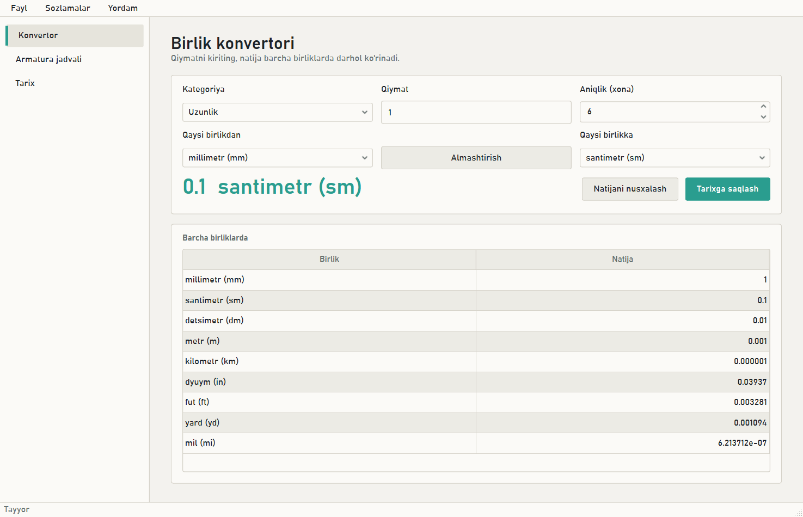
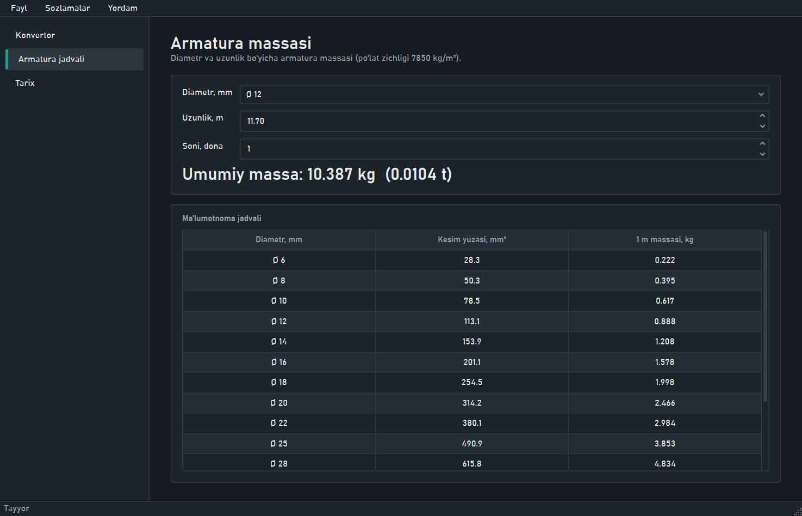

# Birlik konvertori: Uslubiy ko‘rsatma

Muallif: Hakimov Bahtiyorjon. Versiya: 1.0.2.

## 1. Uslubiy ko‘rsatmaning maqsadi va vazifalari

Ushbu uslubiy ko‘rsatma “Birlik konvertori” dasturidan oliy ta’lim muassasalari, kollej va texnikumlarda o‘quv mashg‘ulotlarida hamda tashkilotlarda kasbiy faoliyatda foydalanishni tashkil etish bo‘yicha tavsiyalarni o‘z ichiga oladi.

Ko‘rsatmaning maqsadi talabalarda o‘lchov birliklari tizimini tushunish, birliklarni to‘g‘ri o‘tkazish va natijaning ishonchliligini tekshirish ko‘nikmalarini dasturiy vosita yordamida shakllantirishdir.

Vazifalar:

- talabalarni Xalqaro birliklar tizimi (SI) va amaliyotda qo‘llanadigan tizimdan tashqari birliklar (kgk/sm², tk/m², atmosfera, sotix, dyuym va boshqalar) o‘rtasidagi bog‘lanish bilan tanishtirish;
- chiziqli va chiziqli bo‘lmagan o‘tkazishlar (harorat shkalalari, nishablik va burchak) farqini ko‘rsatish;
- qurilish amaliyotidagi masalalarni (bosim, maydon, armatura massasi) yechishda dasturdan foydalanishni o‘rgatish;
- qo‘lda bajarilgan hisob natijasini dastur natijasi bilan solishtirish orqali o‘z-o‘zini nazorat qilish ko‘nikmasini rivojlantirish;
- hisob-kitoblarni hujjatlashtirish (tarix va CSV eksport) madaniyatini shakllantirish.
Ko‘rsatmada dasturning faqat haqiqatan mavjud imkoniyatlariga tayaniladi: 12 ta kategoriyadagi 70 ta birlik, qiymatni barcha birliklarda bir vaqtda ko‘rsatish, 0 dan 12 gacha aniqlikni sozlash, armatura massasi kalkulyatori va ma’lumotnoma jadvali, hisob-kitoblar tarixi va CSV eksport. Dastur internetsiz ishlagani va o‘rnatishni talab qilmagani uchun uni kompyuter sinflarida tarmoq sozlamalarisiz qo‘llash mumkin. Interfeysning o‘zbek, rus va ingliz tillarida mavjudligi turli ta’lim tilidagi guruhlarda bir xil topshiriqlardan foydalanishga imkon beradi.

Dastur hisoblashni o‘qituvchi va talaba o‘rniga bajaradigan “qora quti” sifatida emas, balki qo‘lda bajarilgan hisobni tekshirish va birliklar o‘rtasidagi munosabatni ko‘rgazmali ko‘rsatish vositasi sifatida qo‘llanishi tavsiya etiladi. Shu sababli amaliy topshiriqlarning aksariyatida avval qo‘lda hisoblash, so‘ngra natijani dastur bilan solishtirish talab etiladi.

## 2. Qo‘llash sohasi va maqsadli auditoriya

Dasturdan quyidagi fanlar va kurslarda foydalanish tavsiya etiladi:

- fizika (o‘lchov birliklari, bosim, kuch, energiya, harorat mavzulari);
- metrologiya, standartlashtirish va sertifikatlashtirish;
- qurilish materiallari, temir-beton konstruksiyalar, qurilish texnologiyasi;
- qurilish smetasi va materiallar hisobi;
- yer tuzish va kadastr (sotix, gektar, akr bilan ishlash);
- informatika va axborot texnologiyalari (ma’lumot hajmi birliklari, CSV formati).
Maqsadli auditoriya: “Qurilish”, “Sanoat va fuqarolik qurilishi”, “Arxitektura”, “Muhandislik kommunikatsiyalari”, “Metrologiya” yo‘nalishlari talabalari, kollej va texnikumlarning texnik yo‘nalishdagi o‘quvchilari, shuningdek ularning o‘qituvchilari.

Dastur bilan ishlash uchun talabadan maxsus tayyorgarlik talab etilmaydi: kompyuterda oynalar, ro‘yxatlar va menyular bilan ishlash ko‘nikmasi yetarli. Shu bois uni birinchi kurs talabalari bilan ham, yuqori kurslarda konstruksiyalarni hisoblash fanlarida ham qo‘llash mumkin. Birinchi holatda asosiy e’tibor birliklar tizimining o‘ziga, ikkinchi holatda esa kasbiy masalalarni tezkor tekshirishga qaratiladi.

Kasbiy faoliyatda dastur loyiha va smeta hujjatlarini tayyorlovchi muhandislar, prorab va texnik nazorat mutaxassislari uchun me’yoriy hujjatlar va xorijiy kataloglardagi qiymatlarni tekshirish, armatura massasini tezkor baholash va bajarilgan hisoblarni qayd etish vositasi sifatida xizmat qilishi mumkin.

## 3. O‘quv mashg‘ulotida foydalanish tartibi

Quyida “O‘lchov birliklari va ularni o‘tkazish” mavzusidagi 80 daqiqalik amaliy mashg‘ulot rejasi keltirilgan. Har bir talaba uchun Windows 10 yoki 11 o‘rnatilgan kompyuter va BirlikKonvertori.exe fayli oldindan tayyorlab qo‘yilishi kerak. Internet talab qilinmaydi.

1. **Tashkiliy qism (5 daqiqa).** Davomatni aniqlash, mashg‘ulot maqsadi va natijalarini e’lon qilish, kompyuterlarda dastur ishga tushishini tekshirish.
2. **Nazariy qism (20 daqiqa).** SI asosiy va hosilaviy birliklari, o‘nlik qo‘shimchalar (milli, santi, kilo, mega), tizimdan tashqari birliklar. Asosiy birlik va ko‘paytuvchi tushunchasi: ixtiyoriy ikki birlik orasidagi o‘tkazish asosiy birlik orqali bajarilishi. Chiziqli bo‘lmagan holatlar: harorat shkalalaridagi siljish, nishablik foizi va burchak orasidagi tangens bog‘lanishi. Armatura massasini π·d²/4·ρ·L formulasi bilan hisoblash.
3. **Dastur bilan tanishtirish (10 daqiqa).** O‘qituvchi proyektor orqali “Konvertor”, “Armatura jadvali” va “Tarix” bo‘limlarini, “Barcha birliklarda” jadvalini, “Aniqlik (xona)” maydonini va “Tarixga saqlash” tugmasini namoyish qiladi.
4. **Amaliy qism (35 daqiqa).** Talabalar “Amaliy topshiriqlar” bo‘limidagi topshiriqlarni bajaradi. Har bir topshiriqda avval qo‘lda (yoki kalkulyatorda) hisoblash, so‘ngra natijani dastur bilan tekshirish talab etiladi. Natijalar “Tarixga saqlash” orqali qayd etiladi.
5. **Yakuniy qism (10 daqiqa).** Talabalar tarixni CSV faylga eksport qilib, o‘qituvchiga topshiradi. Natijalar muhokama qilinadi, xatolar tahlil qilinadi, uyga vazifa beriladi.
Mashg‘ulotdan oldin o‘qituvchi dasturni o‘zi ishga tushirib, barcha kompyuterlarda o‘zbek tili tanlanganini tekshirishi, proyektor uchun esa “Sozlamalar” menyusidan yorug‘ mavzuni tanlashi tavsiya etiladi, chunki yorug‘ fonda jadval qatorlari katta ekranda aniqroq o‘qiladi. Guruhda turli tillarda tahsil oluvchi talabalar bo‘lsa, ular “Til” bandi orqali o‘zlariga qulay tilni tanlashlari mumkin; topshiriqlar va natijalar tildan qat’i nazar bir xil bo‘ladi.

*1-rasm. Mashg‘ulotda namoyish qilinadigan “Konvertor” sahifasi: tanlangan qiymat “Barcha birliklarda” jadvalida uzunlikning to‘qqizta birligida ko‘rsatilgan*

## 4. Amaliy topshiriqlar

1. **Bosim birliklari.** Beton sinfiga mos mustahkamlik 25 MPa deb olinsin. Uni kgk/sm² va tk/m² birliklariga qo‘lda o‘tkazing (1 kgk/sm² = 98066,5 Pa), so‘ngra “Bosim / kuchlanish” kategoriyasida tekshiring. Kutilgan natija: taxminan 254,93 kgk/sm² va 2549,3 tk/m²; “Barcha birliklarda” jadvalida qiymat bar, atm va psi da ham ko‘rinadi.
2. **Yer maydoni.** 0,12 gektar maydonni sotix va m² ga o‘tkazing. Kutilgan natija: 12 sotix, 1200 m². Qo‘shimcha ravishda 1 akrning necha sotix ekanini aniqlang (taxminan 40,47 sotix).
3. **Harorat shkalalari.** −40 °C, 0 °C va 100 °C qiymatlarini Farengeyt va Kelvin shkalasiga o‘tkazing. Kutilgan natija: −40 °F, 32 °F, 212 °F hamda 233,15 K, 273,15 K, 373,15 K. Talaba nega bu o‘tkazish oddiy ko‘paytirish bilan bajarilmasligini tushuntirsin.
4. **Nishablik va burchak.** Tom nishabligi 30° bo‘lsa, uning foizdagi qiymatini toping; rampa nishabligi 8 % bo‘lsa, burchagini toping. Kutilgan natija: 30° taxminan 57,74 % ga, 8 % taxminan 4,57° ga teng.
5. **Armatura massasi.** Ø16 diametrli, uzunligi 11,70 m bo‘lgan 50 dona sterjenning massasini qo‘lda (π·d²/4·7850·L·n) va dasturda hisoblang. Kutilgan natija: 1 metr massasi 1,578 kg, umumiy massa taxminan 923 kg (0,923 t). Natijani “Ma’lumotnoma jadvali” bilan solishtiring.
6. **Xorijiy o‘lchamlar.** Quvur diametri 3/4 dyuym (0,75 in) bo‘lsa, uni millimetrga o‘tkazing; 150 psi bosimni bar va MPa ga o‘tkazing. Kutilgan natija: 19,05 mm; taxminan 10,34 bar va 1,034 MPa.
7. **Ma’lumot hajmi.** 4,7 GB hajmni MB va KB ga o‘tkazing. Kutilgan natija: 4812,8 MB va 4 928 307,2 KB. Talaba dasturda 1 KB = 1024 bayt qabul qilinganini izohlasin.
8. **Hujjatlashtirish.** 1–7-topshiriqlar natijalarini “Tarixga saqlash” tugmasi bilan qayd eting, “Tarix” bo‘limidan “CSV ga eksport” orqali familiyangiz yozilgan faylga saqlang va faylni elektron jadvalda ochib tekshiring. Kutilgan natija: har bir yozuv sana, vaqt, boshlang‘ich qiymat va natija bilan alohida qatorda joylashgan CSV fayl.

*2-rasm. Armatura massasini hisoblash topshirig‘i uchun “Armatura jadvali” sahifasi: diametr, uzunlik va son maydonlari hamda ma’lumotnoma jadvali*

## 5. Baholash mezonlari

Amaliy mashg‘ulot natijasi 100 ball tizimida baholanadi. Ballar quyidagicha taqsimlanadi:

- 1–7-topshiriqlarning to‘g‘ri bajarilishi: har biri 8 balldan, jami 56 ball (qo‘lda hisoblash uchun 4 ball, dastur bilan tekshirish va mos kelishini izohlash uchun 4 ball);
- 8-topshiriq (tarix va CSV fayl to‘g‘ri tuzilgani): 10 ball;
- chiziqli va chiziqli bo‘lmagan o‘tkazishlar farqini og‘zaki yoki yozma tushuntirish (3- va 4-topshiriqlar asosida): 14 ball;
- nazorat savollariga javoblar: 15 ball;
- ish madaniyati, vaqtga rioya qilish va natijalarni aniq rasmiylashtirish: 5 ball.
Yakuniy baho: 86–100 ball “a’lo”, 71–85 ball “yaxshi”, 56–70 ball “qoniqarli”, 55 ball va undan kam “qoniqarsiz”. Ta’lim muassasasida boshqa baholash shkalasi qabul qilingan bo‘lsa, ballar mutanosib ravishda qayta hisoblanadi.

## 6. Nazorat savollari

1. Asosiy birlik va ko‘paytuvchi tushunchalarini tushuntiring. Ixtiyoriy ikki birlik orasidagi o‘tkazish qanday bajariladi?
2. Nima uchun harorat shkalalari orasidagi o‘tkazishni bitta ko‘paytuvchi bilan ifodalab bo‘lmaydi?
3. Nishablik foizi va burchak gradusi qanday formula bilan bog‘langan? 100 % nishablik necha gradusga teng?
4. 1 kgk/sm², 1 atm va 1 bar orasidagi farqni ko‘rsating.
5. Sotix va gektar qanday bog‘langan? 1 gektarda necha sotix bor?
6. Armatura 1 metrining massasi qanday formula bilan hisoblanadi? Formulada qaysi zichlik qiymati ishlatiladi?
7. Nima uchun dasturdagi armatura massasi nazariy qiymat hisoblanadi?
8. Dasturda 1 KB necha baytga teng deb olingan va bu o‘nlik qo‘shimchalardan qanday farq qiladi?
9. Ilmiy yozuvdagi 6.213712e-07 soni nimani bildiradi?
10. Hisob-kitoblarni tarixga saqlash va CSV faylga eksport qilish kasbiy faoliyatda qanday ahamiyatga ega?

## 7. Mustaqil ish uchun tavsiyalar

- O‘z mutaxassisligingizga oid me’yoriy hujjat yoki texnik katalogdan turli birliklarda berilgan 10 ta qiymatni toping, ularni SI birliklariga o‘tkazing va natijani dastur yordamida tekshiring.
- Kichik qurilish obyekti (masalan, poydevor yoki ustun) uchun armatura spetsifikatsiyasini tuzing: har bir diametr bo‘yicha uzunlik va sonni aniqlab, umumiy massani dasturda hisoblang.
- Harorat, bosim va energiya kategoriyalarida bir nechta qiymat uchun “borib-qaytish” tajribasini o‘tkazing: qiymatni bir birlikdan ikkinchisiga, so‘ngra yana dastlabkisiga o‘tkazib, natija tiklanishini kuzating.
- “Aniqlik (xona)” qiymatini o‘zgartirib, yaxlitlashning natijaga ta’sirini tahlil qiling va qaysi masalada necha kasr xonasi yetarli ekanini asoslang.
- Bajarilgan ishlarni tarixga saqlang va CSV faylni elektron jadvalda ochib, qisqa hisobot tayyorlang.
- Ma’lumot hajmi kategoriyasida 1 GB ni bayt va MB ga o‘tkazing, natijani saqlash qurilmalari qadoqlarida ko‘rsatilgan o‘nlik (1000 lik) qiymatlar bilan taqqoslang va farqning sababini yozma izohlang.
- Kuch va bosim kategoriyalari orasidagi bog‘lanishni o‘rganing: 1 tk kuch 1 m² yuzaga ta’sir qilganda bosim 1 tk/m² ekanini, shuningdek 1 MPa = 1 N/mm² ekanini dastur yordamida tekshiring.
Mustaqil ish natijalari yozma hisobot shaklida topshiriladi. Hisobotda masala sharti, qo‘lda bajarilgan hisob, dastur natijasi, ular orasidagi farq (bo‘lsa) va uning sababi, shuningdek CSV fayldan ko‘chirma keltirilishi tavsiya etiladi. O‘qituvchi hisobotni baholashda nafaqat son natijaning to‘g‘riligiga, balki birliklar yozilishining aniqligiga va xulosalarning asoslanganligiga ham e’tibor beradi.

## 8. Xavfsizlik va axborot madaniyati qoidalari

- Dasturni faqat uning rasmiy GitHub sahifasidagi “Releases” bo‘limidan yuklab oling. Noma’lum manbalardan olingan exe fayllarni ishga tushirmang.
- SmartScreen ogohlantirishini faqat fayl rasmiy manbadan olinganiga ishonch hosil qilgandan keyin chetlab o‘ting.
- Dastur natijasini javobgarlik yuqori bo‘lgan hujjatlarga (loyiha, smeta, dalolatnoma) kiritishdan oldin qo‘lda yoki boshqa manba bilan tekshiring. Armatura massasi nazariy qiymat ekanini yodda tuting.
- CSV faylni eksport qilishda fayl nomini aniq va tushunarli tanlang, ish natijalarini tartibli papkalarda saqlang.
- Umumiy foydalanishdagi kompyuterlarda ishni tugatgach tarixni “Tozalash” tugmasi bilan o‘chiring, agar u boshqalar ko‘rishi kerak bo‘lmagan ma’lumotlarni o‘z ichiga olsa.
- Kompyuter sinfida ishlashda texnika xavfsizligi qoidalariga rioya qiling: elektr jihozlariga ruxsatsiz tegmang, ish joyini toza saqlang, ko‘z charchashining oldini olish uchun tanaffuslar qiling.
- Boshqalarning hisob-kitob fayllarini ruxsatsiz nusxalamang va o‘z nomingizdan topshirmang.
